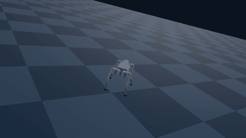
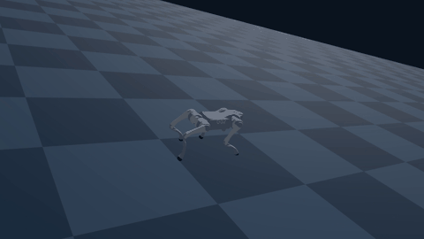
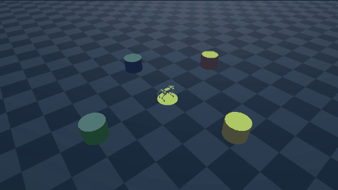

# 転倒に強い犬型ロボット

押されても踏ん張り、倒れても自分で起き上がって、巡回を続ける四足歩行ロボット（Unitree Go2）を、シミュレータ Genesis の上で強化学習（PPO）で作った。
言葉で巡回の順番を指示すると LLM が旗の順番に直し、VLM がカメラの画像から旗を見つけて、犬がそこへ向かう。

動画（1分52秒）: https://youtu.be/3WTVy0TF0XM

## 見どころ

| 押されて倒れても、自分で起き上がる | 走りながら押されても、立て直して走り続ける | 言葉の指示で、旗を順に巡回する |
|---|---|---|
|  |  |  |

## できること

| 場面 | 中身 |
|---|---|
| 押されても踏ん張る | 学習中に、5秒ごとにランダムな向きと強さ（最大 4.0 m/s）で胴体を押す |
| 倒れても起き上がる | 学習の各回を、ランダムに転がした姿勢から始め、「立っているほど加点」の報酬を与える |
| 歩き・走りながら | 前に進む速さの命令（0〜1.5 m/s）に従いながら、上の2つをこなす |
| 向きを立て直す | 目標の向きとのずれに比例して「回れ」と命令し、押されたあとも元の向きや目的地の方向へ戻る |
| 言葉で巡回の指示 | 「緑に寄ってから黄色に行って」を LLM（Qwen3-1.7B）が旗の順番に直す |
| 旗を見つける | 天井カメラの画像、または犬の頭のカメラの画像から、VLM（Qwen2.5-VL-3B）が旗を見つける |

## 自分で書いた部分と、AI に書いてもらった部分

- **自分で書いた**（AI のヒントあり。一部は答えを見せてもらった）: `locomotion/go2_env.py` の押す処理（`_push_robots`）、転がった姿勢からのリセット、`_reward_upright`、向きの命令（`target_yaw`）と、`locomotion/go2_train.py` の学習の設定、`locomotion/vlm_locate.py` の VLM に画像と質問を渡して旗の枠を受け取る処理（`ask_box`）
- **AI（Claude）に書いてもらった**: LLM・VLM の連携（`llm_route.py`、`vlm_locate.py` の `ask_box` 以外）、録画（`go2_record*.py`）、評価（`go2_push_eval.py`）、動画の組み立て（`make_video.py`）
- **公式サンプルのまま**: `locomotion/go2_env.py`・`go2_train.py`・`go2_eval.py`・`go2_backflip.py`・`backflip/` の元の部分は、[Genesis](https://github.com/Genesis-Embodied-AI/Genesis) v1.4.5 の `examples/locomotion`（Apache-2.0、`locomotion/LICENSE`）

git のコミットも、この分担で分けてある。

## 動かし方

[uv](https://docs.astral.sh/uv/) と NVIDIA の GPU（RTX 5070 Ti で確認）を想定。

```bash
uv sync
cd locomotion

# 学習（押される・起き上がる・歩く・走る・向きを立て直す。2000回で約7分）
uv run python go2_train.py -e go2-run2 --max-iterations 2000

# 押す向きと強さごとに、倒れた割合と起き上がれた割合を数える
uv run python go2_push_eval.py -e go2-run2 --ckpt 1999

# 言葉の指示 → LLM → 旗の順番 → 天井カメラ ＋ VLM で旗を見つけて巡回
ROUTE=$(uv run python llm_route.py "緑に寄ってから黄色に行って、最後にスタートに戻って" | grep -- "--route" | cut -d' ' -f2)
uv run python go2_record_goals.py -e go2-run2 --ckpt 1999 --flags-seed 0 --route "$ROUTE" --vlm --out videos/vlm_patrol.mp4

# 犬の頭のカメラだけで旗を探して巡回
uv run python go2_record_egocentric.py -e go2-run2 --ckpt 1999 --flags-seed 0 --route "$ROUTE" --pushes "4.5:90:3.0,9.5:0:6.0"
```

LLM と VLM の重みは、初回に Hugging Face から自動でダウンロードされる（このリポジトリには含めない）。

## 使ったもの

- [Genesis](https://github.com/Genesis-Embodied-AI/Genesis) 1.4.5（Apache-2.0）。`examples/locomotion` を土台にした
- [rsl_rl](https://github.com/leggedrobotics/rsl_rl) 5.5（PPO）
- [Qwen3-1.7B](https://huggingface.co/Qwen/Qwen3-1.7B)（Apache-2.0）
- [Qwen2.5-VL-3B-Instruct](https://huggingface.co/Qwen/Qwen2.5-VL-3B-Instruct)（Qwen Research License。研究・非商用に限る）

## 限界と今後

- 平らな床だけ。段差や坂、つまずきやすい地面でも、倒れにくく、倒れても起き上がれるようにしたい
- 犬（方策）自体は空間を認識していない。旗の位置は、シミュレータの位置情報か VLM の画像から外で計算している
- 止まったまま大きく回るのが苦手（学習で大きく回る練習が少なかったため）
- 評価は、条件ごとに実質1回の試験で、学習も1回ずつ
